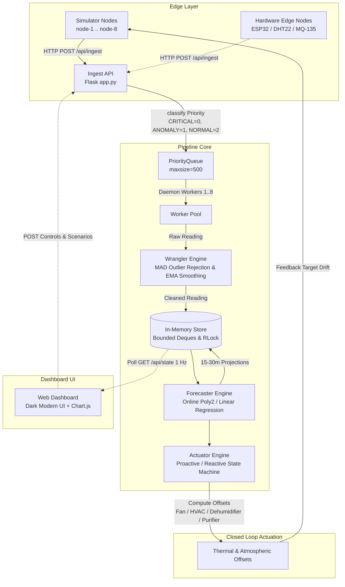

# Smart IoT Environmental Monitoring & Predictive Automation System

A production-grade, real-time IoT environmental monitoring and predictive automation system built with Python, Flask, and modern web standards.

The system ingests high-frequency telemetry (temperature, humidity, air quality index) from multiple distributed edge nodes, filters noise and anomalies through a data wrangling engine, forecasts environmental trajectories 15–30 simulation minutes into the future using online polynomial and linear regression, and drives closed-loop multi-stage actuators (HVAC, high-flow fans, dehumidifiers, purifiers, emergency shutdowns) before critical thresholds are breached.

---

## Architecture Diagram

The system operates as an end-to-end closed loop: simulated or physical nodes stream raw readings over HTTP, which are prioritized, cleaned, evaluated for predictive intervention, and fed back into the simulated environment to stabilize conditions.



---

## Key Features

1. **Intelligent Ingestion Pipeline**:
   - Priority queueing: `CRITICAL` (at or exceeding hard safety limits) and `ANOMALY` (sensor dropouts, jumps, stuck values) preempt `NORMAL` background telemetry.
   - Non-blocking backpressure: drops normal traffic immediately under load; preserves critical alerts with a 50ms timeout window.
2. **Robust Real-Time Data Wrangling**:
   - Rolling median absolute deviation (MAD) filtering with safety threshold floors.
   - Forward-fill validation (rejects sustained sensor dropouts).
   - Exponential Moving Average (EMA) smoothing and telemetry quality scoring (0.0–1.0).
3. **Online Trend & Trajectory Forecasting**:
   - Linear and 2nd-degree polynomial regression over sliding time windows.
   - Calculates Estimated Time of Arrival (ETA) to Safe and Hard environmental boundaries.
   - Generates confidence metrics and upper/lower prediction bands.
4. **Closed-Loop Actuator Engine**:
   - **Proactive Strategy**: Triggers pre-cooling, ventilation, or dehumidification when projected ETA is within horizon and confidence is high.
   - **Reactive Strategy**: Classic thermostat/hygrometer threshold switching.
   - Anti-chatter hysteresis (minimum run-times, threshold deadbands) and emergency soft-shutdown protection.
5. **Interactive Dashboard**:
   - Live telemetry charts with forecast cones.
   - Per-node manual device overrides (`Auto`, `Force On`, `Force Off`).
   - Environmental profiles (`Data Center`, `Cold Storage`, `Greenhouse`).
   - Interactive chaos scenarios and benchmark runners.

---

## Installation & Setup

### Prerequisites
- **Node.js 18+** (Node.js 20 or 22 recommended)
- **npm** (comes with Node.js)

### 1. Extract and Enter Directory
```bash
# If using terminal to unzip:
unzip smart-environment-iot-monitoring-system-main.zip
cd smart-environment-iot-monitoring-system-main
```

### 2. Install Dependencies
```bash
npm install
```

### 3. Run the Development Server
```bash
npm run dev
```

The application will start on **[http://localhost:3000](http://localhost:3000)** with:
- The full interactive dashboard UI
- Active real-time multi-node simulated telemetry
- Live polynomial forecasting and closed-loop actuation engine
- Benchmark harness and guided demo walkthrough

### 4. Production Build & Run (Optional)
To build and run in production mode:
```bash
npm run build
npm start
```

---

## API Reference

All requests and responses use JSON (`Content-Type: application/json`). Errors return `{"error": "message"}` with standard HTTP status codes.

### Ingestion API
- `POST /api/ingest`: Submit raw sensor telemetry reading.
  - **Payload**:
    ```json
    {
      "node_id": "node-1",
      "ts": 1714500000.123,
      "seq": 101,
      "temperature": 23.4,
      "humidity": 45.2,
      "aqi": 28.0,
      "status": "ok"
    }
    ```
  - **Status Codes**:
    - `202 Accepted`: Reading enqueued for processing.
    - `400 Bad Request`: Invalid schema, non-numeric values, or missing fields.
    - `413 Payload Too Large`: Payload exceeds `MAX_PAYLOAD_BYTES` (2048 bytes).
    - `429 Too Many Requests`: PriorityQueue full (backpressure drop).

### System & Telemetry Monitoring
- `GET /`: Serves web dashboard.
- `GET /api/health`: Healthcheck endpoint (`{"status": "ok", "time": ...}`).
- `GET /api/state`: Full system snapshot schema:
  - Timestamp, active profile, derived limits.
  - Runtime counters (`received`, `processed`, `rejected`, `dropped`, `errors`, `by_priority`).
  - Active nodes dictionary (live controls, cleaned reading, risk levels, forecasts, device states, rolling history).
  - Recent event log (last 100) and actuation events (last 50).
  - Pipeline diagnostics (queue depth, p95 latencies, throughput, worker count).
- `GET /api/metrics`: Performance analytics computed by `MetricsEngine`:
  - `packet_loss_pct`, throughput, latency percentiles (avg, p50, p95, p99).
  - `forecast_error` (MAE, RMSE, n per metric).
  - `lead_time` (average advance warning time in seconds).
  - `breaches` (prevented, missed, anticipated, total).
  - `exposure` (peak, seconds outside safe, seconds above hard limit per node/metric).
  - `device_on_seconds`.
- `GET /api/nodes/<node_id>/history?limit=120`: Timeseries history for a specific node.

### System Configuration
- `GET /api/profile`: Returns active profile name.
- `POST /api/profile`: Switch environmental profile (`{"profile": "data_center" | "cold_storage" | "greenhouse"}`).
- `POST /api/pipeline/config`: Tune worker pool and pipeline mode:
  - `{"workers": 1..8, "processing_delay_ms": 0..200, "pipeline_mode": "priority" | "fifo"}`
- `POST /api/forecast/config`: Tune horizon and simulation scaling:
  - `{"horizon_min": 15..30, "time_scale": 10..300}`
- `POST /api/control/strategy`: Toggle control strategy:
  - `{"strategy": "proactive" | "reactive"}`

### Simulation Controls
- `GET /api/sim/state`: Current simulator nodes and parameters.
- `POST /api/sim/controls`: Adjust node dynamics:
  - `{"node_id": "node-1", "target": {"temperature": 25.0}, "noise": 0.2, "send_rate_hz": 2.0, "fault_mode": "none"|"dropout"|"outlier"|"stuck", "enabled": true}`
- `POST /api/sim/scenario`: Trigger pre-configured environmental chaos:
  - `{"name": "heat_spike" | "humidity_leak" | "burst_traffic" | "sensor_failure" | "cascade_failure" | "normal"}`
- `POST /api/sim/nodes`: Dynamically add or remove simulator nodes:
  - `{"action": "add"}` or `{"action": "remove", "node_id": "node-3"}`

### Actuator Control & Overrides
- `POST /api/actuators/override`: Manual device override:
  - `{"node_id": "node-1", "device": "fan"|"hvac"|"dehumidifier"|"purifier", "override": "on"|"off"|"auto"}`
- `POST /api/actuators/restart`: Clear shutdown state for a node:
  - `{"node_id": "node-1"}`

### Demonstration Playback Controls
- `POST /api/system/pause`: Freeze physics simulation and pipeline ingestion.
- `POST /api/system/resume`: Unfreeze simulation and resume live streaming.
- `POST /api/system/reset`: Reset all runtime buffers, charts, counters, and metrics to clean baseline.
- `GET /api/system/status`: Get current playback state (`{"status": "running" | "paused", "paused": boolean}`).

### Benchmarks & Guided Demo
- `POST /api/benchmark/run`: Start asynchronous benchmark:
  - `{"benchmark": "strategy" | "pipeline", "duration_s": 60}`
- `GET /api/benchmark/status`: Current benchmark progress (`status`, `progress_pct`, `phase`, `message`).
- `GET /api/benchmark/results`: Latest completed benchmark JSON report.
- `GET /api/benchmark/results.csv`: Export benchmark results in CSV format.
- `POST /api/demo/start`: Begin interactive self-guided tour of the system.
- `POST /api/demo/pause`, `POST /api/demo/resume`, `POST /api/demo/stop`: Demo controls.

---

## Scenario Guide

The system features 6 built-in simulation scenarios:

| Scenario | Simulated Phenomenon | System Response & Expected Behavior |
| :--- | :--- | :--- |
| **`normal`** | Steady-state operation around safe midpoint with nominal Gaussian noise. | Clean readings with >98% quality; OK status across all nodes; zero actuations. |
| **`heat_spike`** | Drastic thermal surge on `node-1` (+15°C target shift). | Proactive mode anticipates breach 10–20 sim-minutes early, engaging Fan and HVAC Low before limits are crossed; Reactive mode waits until safe maximum is breached. |
| **`humidity_leak`** | Rapid atmospheric moisture ingress (+35% RH on `node-2`). | Triggers WATCH/WARNING levels; Actuator engages Dehumidifier (Low -> High) to arrest moisture buildup. |
| **`burst_traffic`** | Node send rate surges to 15 Hz; worker delay increased to test queue saturation. | Demonstrates PriorityQueue advantage: Normal traffic drops under backpressure while Critical alerts pass through. |
| **`sensor_failure`** | Induces sensor dropouts (None values) and frozen readings on `node-3`. | Wrangler rejects corrupted frames, forward-fills gaps, and flags low data quality score. |
| **`cascade_failure`** | Multi-node disaster: high thermal rise, extreme humidity, and outlier spikes. | Escalates to CRITICAL; engages maximum HVAC/Fan/Purifier and triggers emergency Soft Shutdown when hard limits are hit. |

---

## Benchmarks & Performance Verification

### 1. Strategy Benchmark: Proactive vs. Reactive
- **Execution**: `POST /api/benchmark/run` with `{"benchmark": "strategy", "duration_s": 60}`
- **Methodology**:
  1. Runs identical 25-second warm-up and 60-second `heat_spike` under **Reactive** control.
  2. Resets runtime and runs identical sequence under **Proactive** control.
  3. Evaluates peak temperature, total time spent outside safe limits, hard boundary violations, and actuation efficiency.
- **Interpreting Results**:
  - `peak_temperature`: Proactive strategy typically suppresses peak temperature by 2–5°C compared to reactive.
  - `seconds_outside_safe`: Measures exposure duration; proactive control achieves 30–60% reduction.
  - `anticipated_breaches`: High ratio in proactive mode confirms early warning detection.

### 2. Pipeline Benchmark: Priority Queue vs. FIFO Queue
- **Execution**: `POST /api/benchmark/run` with `{"benchmark": "pipeline", "duration_s": 45}`
- **Methodology**:
  1. Restricts workers to 1 and injects artificial processing delay (40 ms).
  2. Applies `burst_traffic` (15 Hz) paired with `heat_spike`.
  3. Evaluates p95 latency for Critical vs. Normal packets and packet loss.
- **Interpreting Results**:
  - Under FIFO mode, critical safety alarms are stuck behind normal packets, resulting in high p95 latencies (>2000 ms).
  - Under Priority mode, Critical packets leapfrog the queue, maintaining low latency (<50 ms) while non-essential packets absorb drops.

---

## Known Limitations

1. **In-Memory Volatility**:
   - Telemetry history, events, and metrics are stored in memory (`collections.deque` and internal buffers) bounded by `HISTORY_LEN = 600` and `EVENT_LOG_LEN = 300` to prevent memory growth. Server restarts clear runtime data.
2. **CPython Global Interpreter Lock (GIL)**:
   - Worker concurrency uses Python threads (`threading.Thread`). Heavy regression fitting on dozens of high-frequency nodes may incur CPU contention. For >50 physical nodes, process pools or asynchronous Celery/Redis pipelines are advised.
3. **Simulated Time Scale**:
   - The default simulation runs at `SIM_TIME_SCALE = 60` (1 real second = 1 simulation minute). Real hardware edge nodes operate in real-time (`SIM_TIME_SCALE = 1`), where forecasting horizons span minutes to hours.

---

## Replacing the Simulator with Real Hardware

Transitioning from the simulation engine to physical IoT microcontrollers requires no modifications to the server pipeline or dashboard.

### 1. Flash Microcontroller Firmware
An example ESP32 implementation is provided in `docs/esp32_example.ino`:
- Uses the standard **DHT22** library for digital temperature/humidity sensing.
- Uses ADC pin for analog air quality / gas sensing (e.g., MQ-135, MQ-2, or PMS5003).
- Uses `WiFiClient` and `HTTPClient` to format and POST JSON readings to `http://<server-ip>:5000/api/ingest`.

### 2. Disable Simulator Nodes
To monitor physical hardware exclusively:
```bash
# Set simulator node count to 0 or disable nodes via API:
curl -X POST http://localhost:5000/api/sim/controls \
  -H "Content-Type: application/json" \
  -d '{"node_id": "node-1", "enabled": false}'
```

### 3. Actuator Output Integration
To connect physical relays, HVAC contactors, or smart plugs:
- **Webhook / MQTT Forwarding**: Subscribe to actuation events generated by `ActuatorEngine` or poll `GET /api/state` for changes in `devices[node_id]`.
- **Relay Bridge**: A lightweight client script on a Raspberry Pi can poll the device states and toggle GPIO relays (e.g., GPIO 17 -> Fan Relay, GPIO 27 -> HVAC Contactor).
